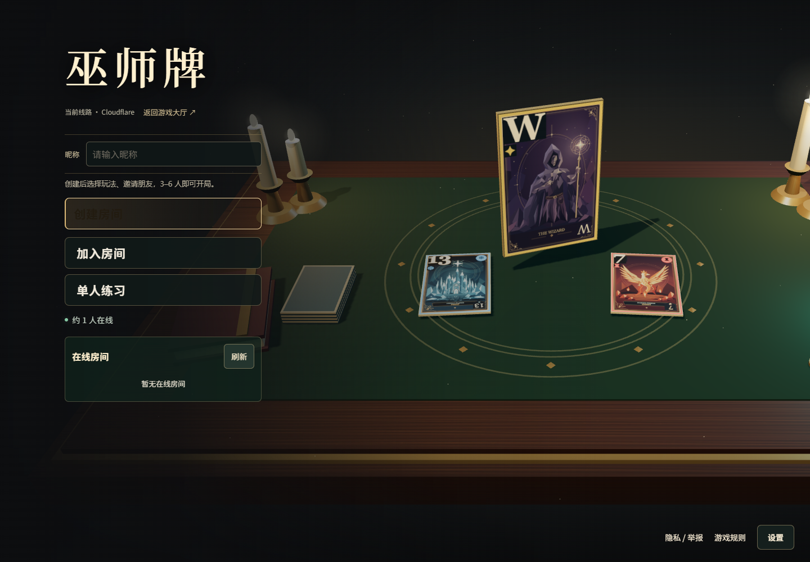
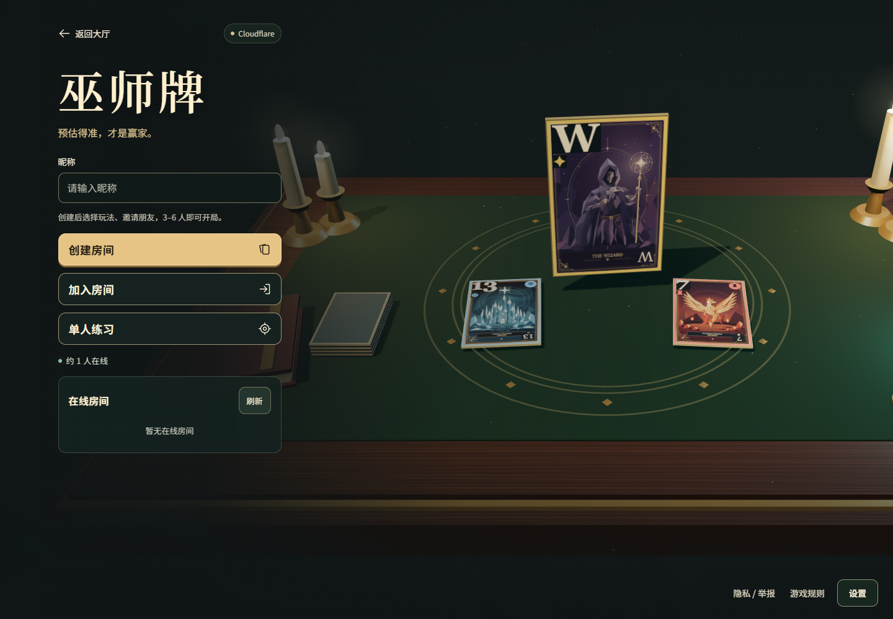
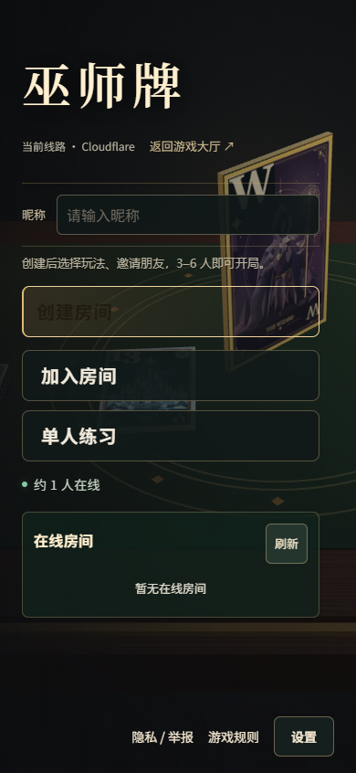
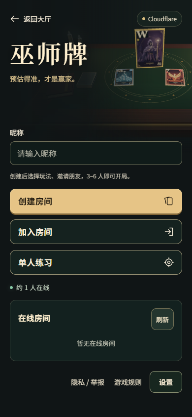
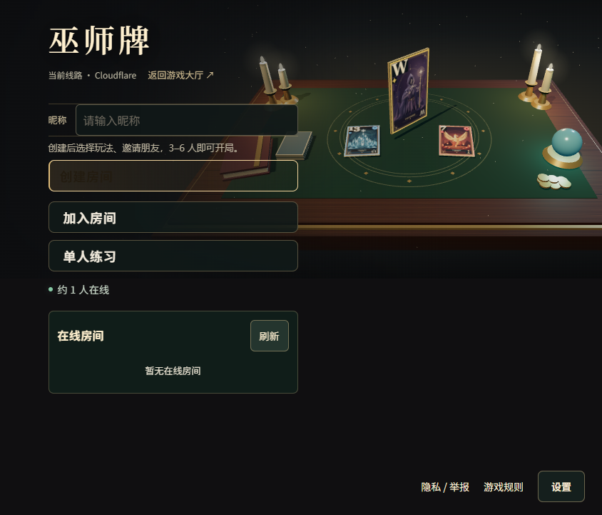
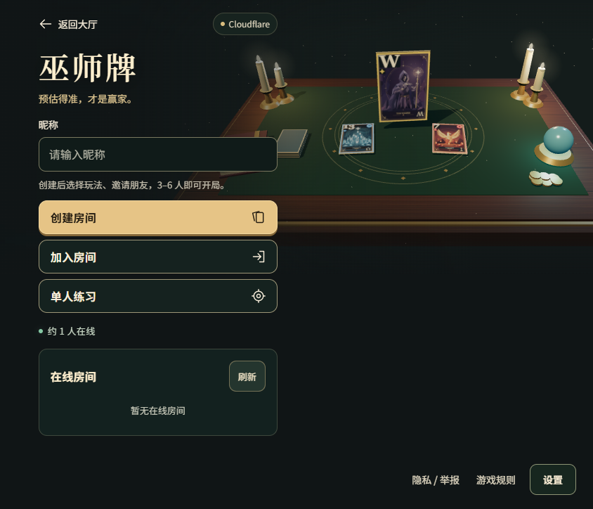

# 巫师牌首页视觉验收

2026-11-06。从执行时最新 `origin/main` (`8df579f128d9235b417419a0d07afeaf9608e1e1`) 建独立工作树；没有覆盖原工作区。范围限于首页结构、样式、首页图标与本地验收证据。

## 修改效果

| 尺寸 | 修改前 | 修改后 |
| --- | --- | --- |
| 桌面 1440×1000 |  |  |
| 手机竖屏 390×844 |  |  |
| 手机横屏 844×390 |  |  |

横屏截图为完整可滚动页面，图片高度超过 390px。主菜单与在线房间自然纵向排列，不依赖裁切或缩小触控目标来强行塞进一个屏幕。

## 设计与修复

- 采用共同入口原则：顶部返回大厅与当前服务器、主题标题、昵称、创建 / 加入 / 单人练习、在线房间、规则与设置。控件最少 44px，主入口 48–52px；按钮与输入圆角 10–12px，按 8 / 12 / 16 / 24px 留白。保留原有暖金、墨绿、卡牌与烛光牌桌，视觉重心仍是巫师卡牌。
- 原问题确认为 `clarity.css` 金底深字被后加载 `room-experience.css` 的透明暗色渐变覆盖。首页规则集中回最后导入的 `home-menu.css`，移除 `clarity.css`、`room-experience.css`、`table-clarity.css` 和 `spectator.css` 中重复的首页布局与按钮定义。默认、悬停、键盘焦点及禁用状态分别成对定义表面色与文字色，不以整体透明度制造禁用状态。
- 昵称独立可见标签、48px 输入、可读 placeholder；返回大厅和菜单动作复用现有 24px / 1.75px 线条 SVG 体系。小屏的插画限制在标题区，并为标题加深遮罩，避免输入和按钮覆盖卡面主体。
- 玩法设置、服务器切换、邀请、恢复、练习与规则入口沿用原逻辑，未改对局、房间状态、联机协议、后端或部署配置。建房后仍直接使用既有玩法选择界面。

## 参考与素材

- [Impeccable](https://github.com/pbakaus/impeccable)：参考视觉层级、间距、响应式和状态审查方法。
- [frontend-design](https://github.com/anthropics/skills/blob/main/skills/frontend-design/SKILL.md)：参考从游戏本身建立视觉方向、保留主题性、克制装饰与浏览器截图自查。
- [UI UX Pro Max](https://github.com/nextlevelbuilder/ui-ux-pro-max-skill)：作为控件一致性与可访问状态的补充阅读。
- 插画与3D均为仓库现有卡面 / 程序化牌桌；新增返回与进入图标为本次手写 SVG 路径。未引入外部图片、字体、依赖、生成式图片或第三方脚本。依赖使用机器上已有的 `node_modules`，没有执行第三方安装脚本。

## 本地验证

- `npm run check`：通过。
- `npm test`：339 / 339 通过，无跳过。
- `npm run test:release`：21 / 21 通过。
- `npm run build`：通过。保留原有 Three.js chunk 大小提示，没有通过改构建阈值隐藏提示。
- `npm run worker:check`：Cloudflare Worker dry-run 通过，未发布。
- `node scripts/entry-design-review.mjs`：Chrome 实际运行，5 个尺寸（1440×1000、390×844、844×390、320×568、768×1024）标题、输入和三个主按钮无相互重叠 / 水平裁切，触控高度合格；加入表单草稿在打开 / 关闭规则后保留。
- 同一脚本测量 6 个控件 × 4 种状态共 24 组颜色，等待过渡结束后取样，均超过 4.5:1。主按钮默认 10.23:1、悬停 / 焦点 12.58:1、禁用 6.19:1。键盘焦点可见，禁用控件保持可读。完整颜色、比值与结果见 [results.json](results.json)。输入与按钮使用实色表面以避免取样误差。
- 本地 Node API 实际创建房间、第二个浏览器上下文通过邀请加入、第三个上下文通过观战邀请进入、单人练习默认五轮：通过，页面 JavaScript 错误 0。建房后原界面证据见 [after-create-desktop.png](after-create-desktop.png)。
- 服务器切换与返回大厅在浏览器中触发，并用本地请求拦截记录最终可信目标；没有跨到公网执行游戏操作，目标 URL 不夹带房间或身份参数。原有发布与邀请单测也通过。
- `git diff --check`：通过。没有手动触发远端 CI，也没有新增发布链；现有 main 验证后自动发布流程保持原样。

复现：启动 `PORT=8787` 的现有 Node 服务、启动 `npm run dev -- --port 5182 --strictPort`，再运行上述专项。可用 `GAME_URL` 覆盖入口，`BROWSER_CHANNEL` 覆盖本机 Chrome 通道。

## 未验证项

手机截图来自本机 Chrome 浏览器视口模拟，未做实体 iPhone / Android、原生 Safari、软键盘或移动网络验收。未进行公网部署或生产链路验收。本次未重复执行整场牌局、长时恢复和全部跨浏览器回归，因为没有改动这些行为。
