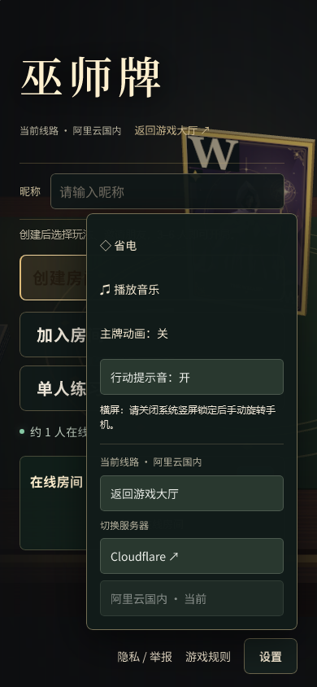
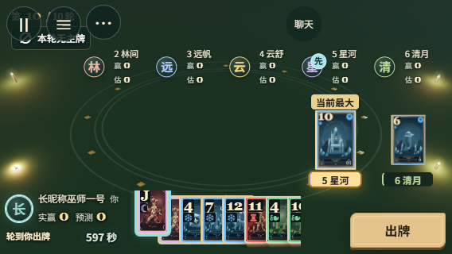
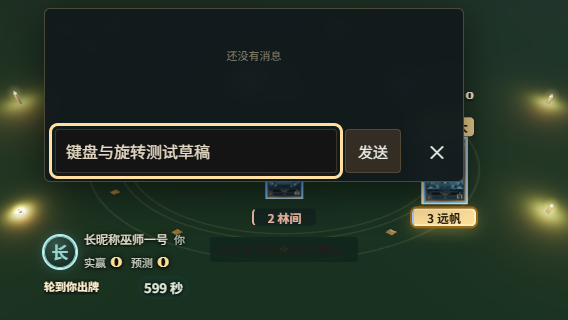
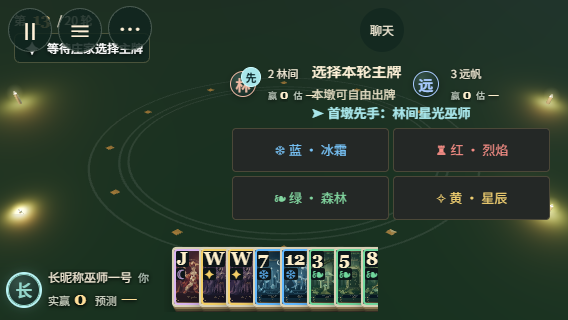

# 一键横屏检查 · 2026-11-05

基于最新 main `7a6d3cb`，独立分支 `codex/review-only/mobile-landscape`。取代[上一轮方向设置弹窗](../room-orientation/README.md)的交互，房间页签、玩法与默认设置沿用当前主分支。

## 玩家看到的行为

手机的设置/牌桌菜单提供「横屏 / 退出横屏」，没有方向选择弹窗、竖屏锁定选项或全屏复选框。点击时先申请整个文档全屏，再调用 `screen.orientation.lock('landscape')`；加载、设备旋转、键盘高度变化和回到页面均不自动申请。

退出只解除本次锁定、退出本次开启的全屏，不强制锁回竖屏，也不关闭玩家原先已有的全屏。浏览器自行退出、取消未完成请求、请求迟到、退出失败后重试或浏览器自行退出均会清理本次状态。菜单重绘后更新按钮显示，不重建聊天、房间连接或游戏状态。

API 缺失、全屏权限关闭或请求被拒绝时，不保留无效的横屏按钮，原位简短提示关闭系统竖屏锁定后手动旋转。默认及退出后继续按真实视口自动布局。桌面鼠标界面隐藏手机方向控件。

## 页面内横向备用方案的评估

本轮工程判断是不加入页面整体 `rotate(90deg)`：牌桌布局调度器和三维投影用真实 DOM/画布矩形，聊天单独挂在 body，键盘使用 `visualViewport`，记分和结算有各自的固定定位、滚动及浮层控制。旋转单个页面容器不能同步改变媒体查询、系统键盘方向和安全区方向，还会影响固定定位的包含块。另做三维投影、输入、门户和浮层的坐标映射需要跨设备实现和验收，不能把简单变换当作可靠后备。

保留未变换的触摸、滚动和实际横竖屏布局，提供明确的手动旋转提示，不承诺网页能绕过系统方向锁定。依据：[Screen Orientation](https://www.w3.org/TR/screen-orientation/)、[Fullscreen API](https://fullscreen.spec.whatwg.org/)、[CSS Transforms 的渲染模型](https://www.w3.org/TR/css-transforms-1/#transform-rendering)。

## 本地证据

Windows，Node 26.13.0，Playwright 1.64.1；Chromium 使用 Edge 156.0.4314.58，WebKit 使用 Playwright WebKit 27.2。

| 检查 | 结果 |
| --- | --- |
| `npm run check` | JavaScript 语法检查通过 |
| `npm run build` | 通过，保留原大分包提醒 |
| 本地方向和界面专项 | Chromium 26 通过；WebKit 25 通过、1 项跳过 |
| 跳过项 | WebKit 移动模拟上下文 `fullscreenEnabled=false`，无法执行原生全屏项 |

方向专项覆盖直接进入/退出、缺少 orientation/lock/fullscreen、全屏策略关闭、权限拒绝、连续切换、未完成锁定和全屏的取消、迟到结果、原有全屏所有权、浏览器退出/替换全屏、退出拒绝与重试、pagehide 清理。Chromium 另以原生 Fullscreen API 和测试模态菜单核对全屏后的可见性和退出；该项的方向锁仍用替身。WebKit 的 API 成功/失败路径使用替身。

真实本地 Node 建房核对只建一次、socket 数不增加、玩法/页签/展开状态、昵称、房间码及聊天草稿保留。合法引擎动作生成的练习存档覆盖选色、预言、六人手牌、触摸选中牌、确认出牌、记分和菜单，以及轮末/终局结算与明细滚动。期间实际触发新按钮进出横屏，核对未提前提交选择或误出牌、选中牌不变、按钮命中正确和无横向溢出。

视口覆盖 390×844 ↔ 844×390、375×667 ↔ 667×375、320×568 ↔ 568×320、360×800 ↔ 800×360、430×932 ↔ 932×430 及 1440×900；结算另测 568×250 / 667×280。安全区使用左右 44px、底部 21px 的样式替身；键盘通过 `visualViewport` 替身模拟剩余 190/210/270/400px 等高度，并聚焦聊天输入。退出横屏后聊天草稿和手牌选择仍在，输入框、发送按钮完整处于剩余可见区内。

选色专项发现原限高的 flex 列仍允许换列，导致按钮移到右侧屏外。现在短横屏选色栏保持单列容器、四个 44px 以上按钮排为两列，并限制安全区内宽高、允许内部滚动；逐个核对四种花色均可命中。

复现：

```sh
npm run check
npm run build
node node_modules/@playwright/test/cli.js test -c playwright.room-experience.config.mjs
```

这些是桌面浏览器内核、移动视口和 API 替身检查。未进行实体 Android/iPhone、iOS Safari、真实系统方向锁、软键盘/输入法、刘海和浏览器工具栏的验证，也未在线部署。没有新增 CI 工作流、job 或远端浏览器矩阵，没有手动触发远端 CI。审查分支沿用 `[skip ci]` 和 review-only 保护；合并消息移除跳过标记后走原有 main 流程。

## 截图





