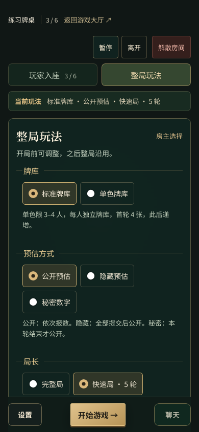
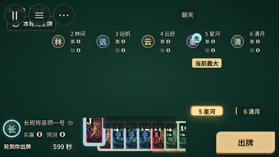
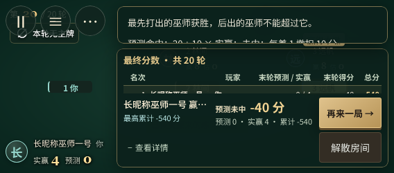
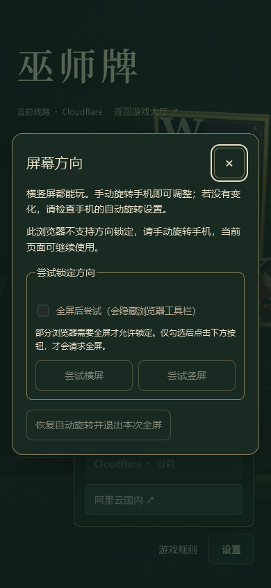

# 建房与手机方向检查 · 2026-11-05

基于 main `cf742c9967bc1749535cec158cfb53cb58ecfd40`，独立工作区；开始时所有已有工作区均干净。保留原“玩家入座 / 整局玩法”页签、默认选择、各页滚动位置及机器人难度，不增加新的建房步骤。

首页将昵称放到创建操作前，提示建房后选择玩法与邀请朋友。房间两页共享当前玩法摘要；牌库、预估方式、局长直接可选，加减预估与先见之明在原玩法页按需展开。开启状态始终可从摘要看见，展开状态在选项更新、换页和旋转后保留。技术说明改为简短玩家语言，房间保存、断线恢复和保留期限仍可查看。

沿用原横屏牌桌和布局调度器；对安全区作小幅补充。短横屏最终成绩由挤在一行的四列改为记分表单独一行，个人结果与操作分开；展开明细的高度由原调度器读取实际结果栏位置后限制，无新增 resize/orientationchange 监听。更短的 250/280px 屏幕使用较短、可滚动的记分表，避免文字和按钮重叠。

## 方向控制与状态

“设置 / 菜单”提供与运动会一致的“屏幕方向”。默认可手动旋转，竖屏继续可玩；点击尝试时才请求横/竖屏锁定，只有明确勾选全屏后点击才请求全屏。API 不支持或拒绝时提示手动旋转。可以恢复自动旋转、退出本次全屏；用户原有全屏不被退出，退出失败可重试。面板常驻在游戏 DOM 外，旋转不重建它、手牌、聊天或房间连接，无 CSS 旋转页面。

锁定能力依赖浏览器和系统的许可及前置条件，参照 [W3C Screen Orientation](https://www.w3.org/TR/screen-orientation/)。支持 API 不保证请求成功。

## 实际本地验证

Windows，Node `26.13.0`、Playwright `1.64.1`；Chromium 使用 Edge `156.0.4314.58`，WebKit 是 Playwright `27.2`，不是 iOS Safari。

| 检查 | 结果 |
| --- | --- |
| 全套单元/集成测试 | 321 / 321 |
| JavaScript 语法及构建 | 通过；保留原有大分包提醒 |
| 新方向、状态与布局浏览器专项 | Chromium 11 + WebKit 11，通过 |
| 原 room-ui-review | Chromium / WebKit 各四种视口，通过 |

覆盖 390×844 ↔ 844×390、375×667 ↔ 667×375、320×568 ↔ 568×320、360×800 ↔ 800×360、430×932 ↔ 932×430、1440×900，结算另测 568×250 / 667×280。原房间回归覆盖 1440×1000、390×844、844×390、320×780，包括 90px 高度变化、长昵称、满座和机器人按钮命中。

新专项核对真实本地 Node 建房不重复、socket 数不增加、页签与可选玩法展开状态、昵称/房间码/聊天草稿保留，以及合法保存状态恢复后的六人手牌、选中牌、确认出牌、记分菜单、轮末/终局结算和可滚动明细。游戏状态 fixture 由合法引擎动作生成，仅放入测试浏览器；未增加产品测试入口。

安全区以样式替身模拟左右 44px、底部 21px；键盘以 visualViewport 事件替身模拟横屏剩余 190/210px 等高度。方向 API 的成功、缺失、拒绝、全屏拒绝/退出失败、连续点击和未完成锁定取消均用 API 替身核对调用顺序。检查无页面横向溢出、操作未被覆盖、旋转不自动出牌；截图已目视检查。

复现：

```sh
npm run check
npm test
npm run build
node node_modules/@playwright/test/cli.js test -c playwright.room-experience.config.mjs
# 启动原本地开发服务后，两种引擎分别执行：
# GAME_URL=http://127.0.0.1:5186/ REVIEW_OUTPUT=.local/room-review BROWSER_ENGINE=webkit node scripts/room-ui-review.mjs
```

## 未覆盖

未实测实体 iPhone/Android、iOS Safari、厂商浏览器、真实方向锁/全屏权限、系统键盘/输入法、刘海及浏览器工具栏、PWA 或移动网络。本地模拟不能代替真机和线上验收。未修改部署、服务器选择、游戏规则、CI 工作流或依赖；未手动触发远端 CI。PR 沿用 review-only 和 `[skip ci]`，合并消息移除标记后使用原 main 流程。

## 截图





