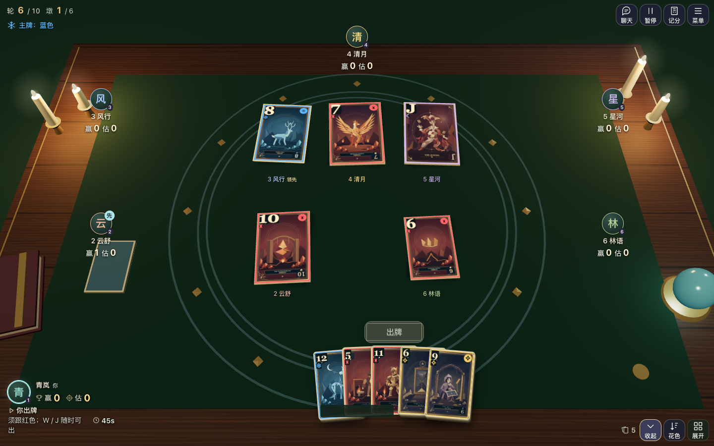
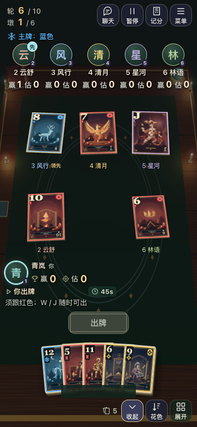
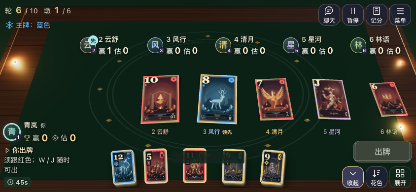
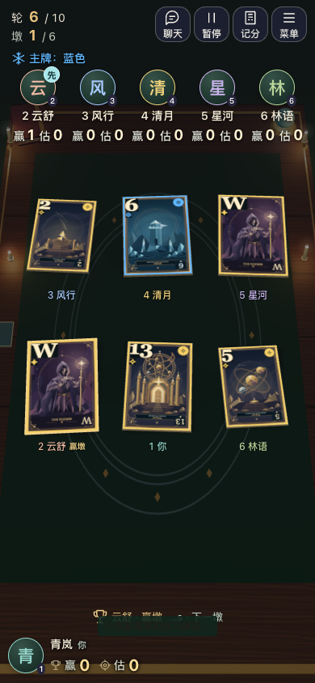

# 巫师牌：卡牌落桌表现验收

2026-11-12；基于个人仓库 `qiuh23/wizard-friends` 的 main `f6864aa7f5a100827ca66749fc64d8196ef68a5e`，独立工作树、分支 `codex/review-only/table-play`。本记录对应本地实现和验收，未推送或部署。

## 完成的表现

- 复用首页木桌、绿毡、烛光、原 SVG 卡面和扇形手牌。对局相机相对桌面 58°，短横屏使用 32° 视场，其余 43°；镜头只随布局/视口变化，出牌与领先变化不会触发镜头运动。
- 牌面回到桌面平面，保留薄实体边和贴毡接触阴影；远近雾不再压暗手机上的点数与花色。桌面/竖屏采用中央小圈落点，短横屏采用顺时针单排，完整预留 3～6 人的所有位置。
- 同一墩的目的地跨 React 挂载保留；后出的牌、领先变化、进入墩末不重新排队。自己出牌从原手牌实际位置开始，其他玩家沿现有席位方向飞入，420ms 内轻落、滑停。
- 领先牌使用细金边、极轻尺寸强调和小型「领先／赢墩」文字，取消抬高悬浮效果。所有判断复用 `winner()`，含先出的 W、全 J、王牌、首攻花色和单色模式同点先出优先。
- 原有预测、实赢、轮次、王牌、选牌确认、3 秒复盘和 1100ms 分批收向赢家的时钟保留。未改规则、权威、传输、昵称、聊天及国内/海外站点策略。

## 本地检查

| 检查 | 结果与范围 |
| --- | --- |
| `npm run check` | 通过：JS 语法及严格 TypeScript |
| `SITE_EDITION=global npm run build` | 通过；仅现有 Three.js 大分块提示 |
| `SITE_EDITION=cn node node_modules/vite/bin/vite.js build --outDir .local/table-play-cn-dist` | 通过：独立目录国内前端构建 |
| `npm test` | 356 项全部通过；Python 3.12.14 |
| `table-play-review.mjs` | 38 组通过，浏览器运行错误 0 |
| `GAME_URL=http://127.0.0.1:8787/ npm run test:smoke` | 真实本地 3 客户端 + 1 观众、5 轮通过，运行错误 0 |

38 组包括：8 种视口 × 3/4/5/6 人 = 32 组真实 WebGL 桌面；3 组关闭 WebGL 的 HTML 备用显示；3 组桌面/手机横竖屏实际选牌、确认出牌、原手牌起点、稳定镜头与旧牌位置、落桌、暂停/恢复、刷新不重放、按既有时钟收牌。视口：1440×900、1280×720、390×844、360×640、844×390、667×375、568×320、932×430。测量实际投影后的四角，检查牌面/归属标签之间以及与玩家和主要操作的遮挡、屏外裁切、整页滚动。

新单测覆盖各人数中央落点和实际牌模；每张牌打出后检查金边归属，涵盖 W 压普通牌、第二个 W 不取代第一个、全 J、弄臣后确立花色、王牌压跟色、无王牌的跟色和单色同点。原有表现时钟用例继续覆盖延迟帧、分批收牌、暂停及恢复。

联机冒烟覆盖创建/加入、房主选项、秘密预测与观众权限、五轮计分同步、自动下一墩/轮、终局与再来、暂停/恢复、刷新还原手牌与身份、网络中断重连、海外聊天、离开返回和解散。此联机用例使用 HTML 牌面；WebGL 动画与布局由上述专用浏览器检查验证。

测试环境前提：首次全量使用系统 Python 3.9.6，`tests/aliyun-archive.test.js` 的 `test_checked_regular_release` 失败，原工作副本 `b6069a8` 也能复现。部署脚本使用了较新的 `hashlib.file_digest` 与 `extractall(filter=...)` API；将现有 Codex runtime 的 Python 3.12.14 放到本次测试的 PATH 前方后，356 项全部通过，无需修改压缩包或部署逻辑。完整最终输出见 [unit-tests.log](unit-tests.log)。

## 截图与证据

| 桌面正常对局 | 手机竖屏正常对局 |
| --- | --- |
|  |  |

| 手机横屏正常对局 | 六人同时落桌：首个 W 获胜 |
| --- | --- |
|  |  |

- [38 组浏览器结果](browser-results.json)
- [联机回归结果](network-results.json)
- [语法/类型检查](check.log)、[海外构建](build-global.log)、[国内构建](build-cn.log)

本地复跑：先启动 Node 后端与 Vite；Vite 的 `/api` 默认代理 8787，给本地后端设置 `ALLOWED_ORIGINS=http://127.0.0.1:5175`。在 `http://127.0.0.1:5175/` 打开一个 Playwright CLI 会话，然后执行：

```sh
playwright-cli -s=wizard-table run-code --filename scripts/table-play-review.mjs
```

浏览器脚本通过合法引擎动作建立练习恢复记录，仅在浏览器响应中注入场景观察引用；没有给生产应用添加测试入口。静态截图固定练习的墙钟；实际联机回归使用真实时间；收牌检查读取并推进表现时钟，不修改权威状态。

## 未验证部分

手机为 Chrome 浏览器视口及触控模拟，未在真实 iOS/Android、Safari、系统安全区/软键盘和真实横竖屏切换上验证。未验证公网国内/海外链路、长时间后台或系统锁屏。本轮国内覆盖构建和现有策略单测；未另跑国内浏览器/多人回归。没有制作视频。
