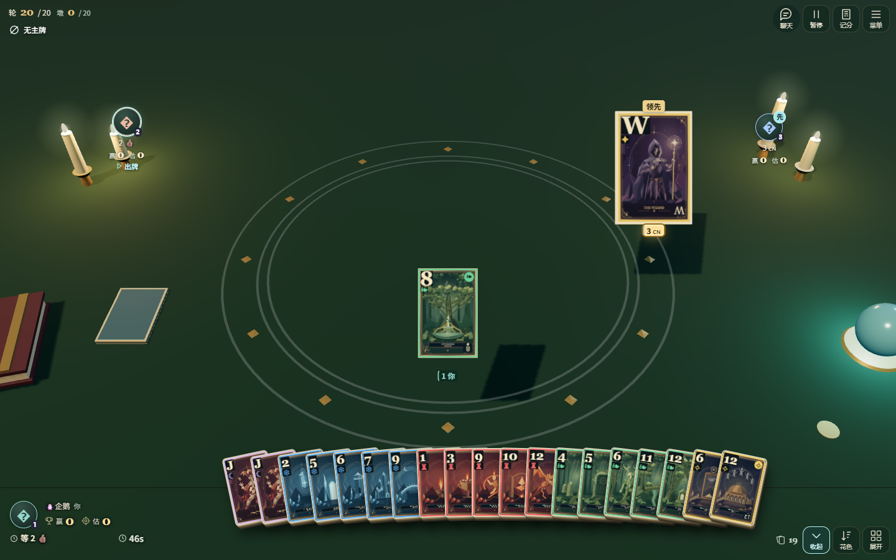
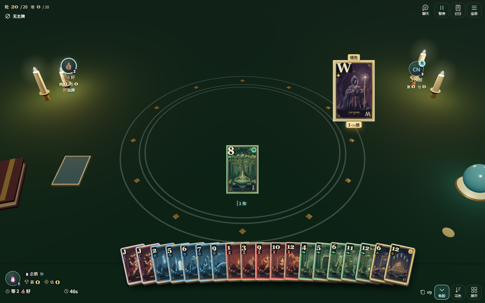
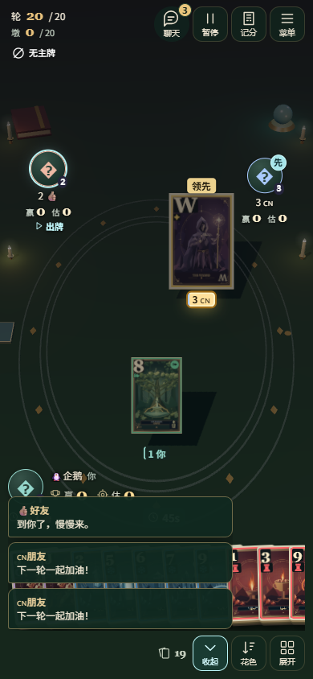
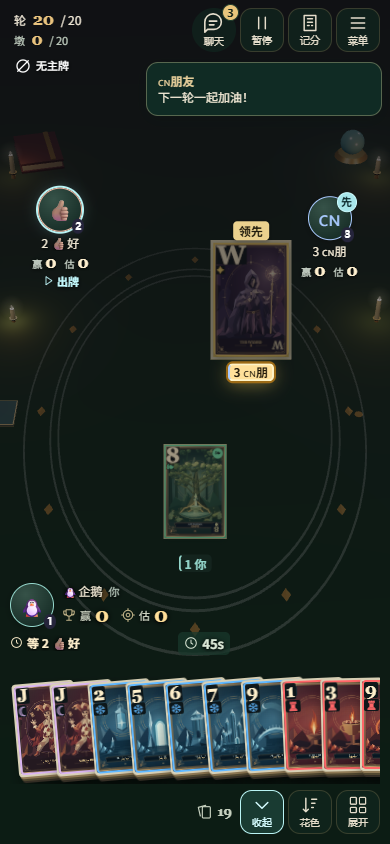
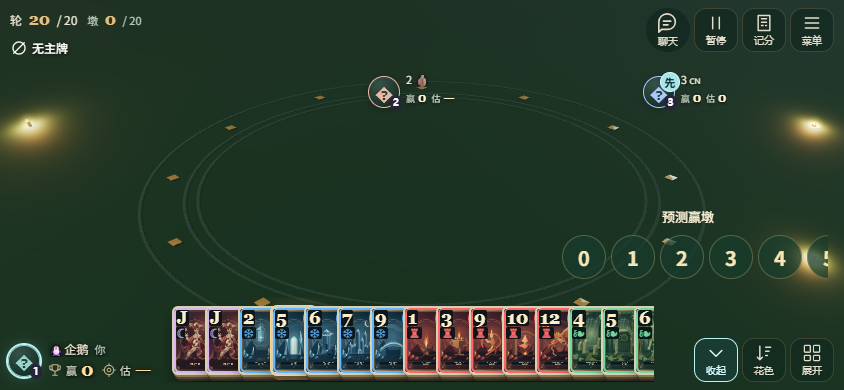
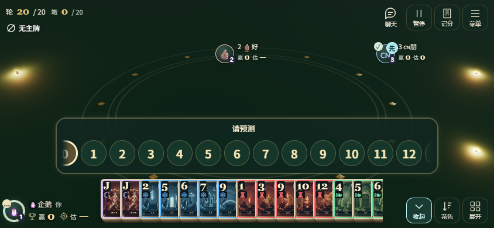
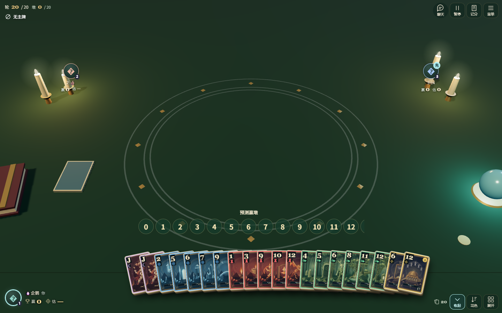
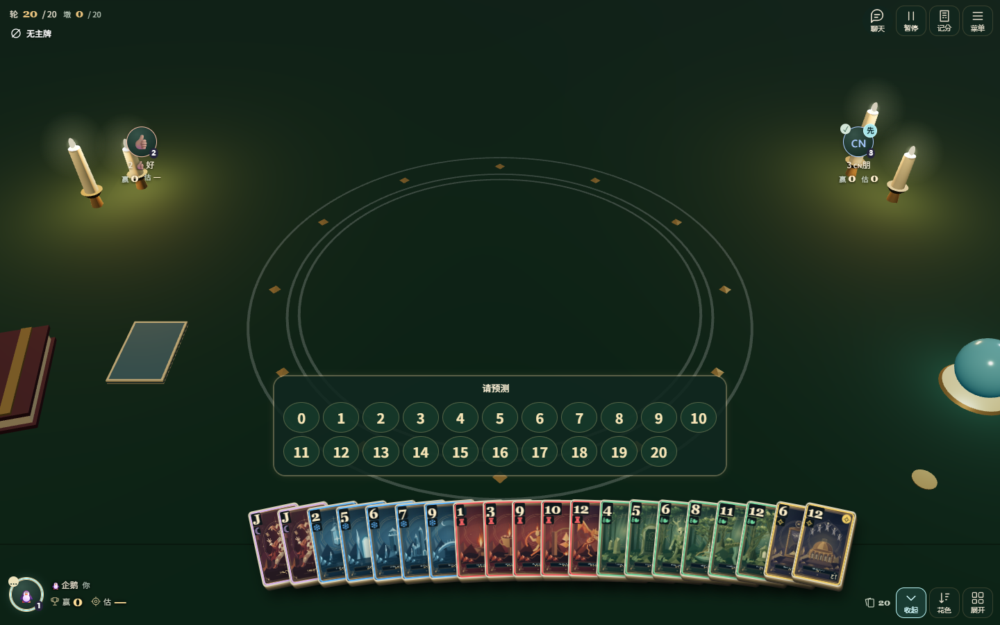
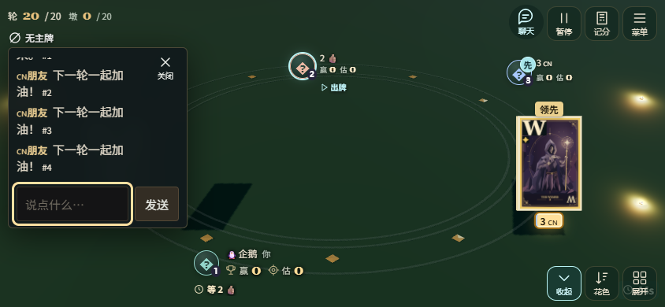
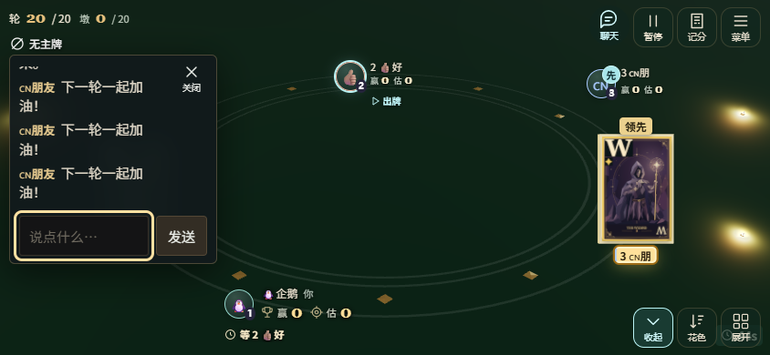

# 巫师牌头像、预测与烛光牌桌验收

2026-11-06。基线 `9141ba8`，修改前截图来自该主分支的独立 checkout；牌局使用同一确定性随机流。仅本地执行，不合并、不发布、不改房间池、规则、发布流程或服务器配置。

## 实现

- 海外头像和短昵称按字素切分：优先 `Intl.Segmenter`，回退处理组合附加符、变体选择符、肤色、旗帜和 ZWJ emoji。HTML 转义保留。昵称只新增对合法 pictographic ZWJ 序列的接受，控制字符、双向控制符、任意隐藏连接符继续拒绝；国内固定天文昵称机制不变。
- 海外新消息只显示一条合并后的最新预览，跟随实际聊天按钮，避开头像、手牌和操作区。8 秒过期，打开记录时清除预览。显示层去掉消息序号；原有 `seq`、顺序、未读、历史和去重保留。
- 两版预测提醒使用公开投影的 `bidSubmitted` 判断。公开预测突出当前玩家；两种同时秘密预测突出所有未提交者，提交后改为 ✓。暂停、断线等待、提交和离开预测阶段停止呼吸；减少动态效果使用静态边框。头像保留完整无障碍名称，✓ / … 让状态不限于颜色。
- 数字按可用宽度排为一至两行；空间不足时仍可横向手势、触控板或鼠标滚轮滚动，滚动条完全隐藏，边缘渐隐提示余项。Tab、方向键及 Home/End 可访问首尾，原点击提交逻辑保留。

## 光影实际来源

`table-scene.js` 使用现有 Three.js：四根蜡烛各有真实 `PointLight`，火焰是基础材质网格，局部光晕是加法 Sprite；两侧暖光配中性柔和半球环境光及宽方向补光。2D 回退的蜡烛和光晕是 CSS 装饰。

原黑色梯形来自抬高后贴合屏幕位置的出牌网格向桌面投影。现在关闭阴影贴图和出牌网格的投射/接收，3D 出牌使用跟随同一出牌动画的低对比 CSS 接触阴影；2D 使用近牌边阴影。牌面继续使用原无光照材质以保持花色和数字可读，领先牌标识保留。蜡烛亮度变化降为低幅慢变化，减少动态效果下静止。

## 本地验证

| 检查 | 结果 |
| --- | --- |
| `npm test` | **354/354 通过**，含字素回退、安全昵称、预测投影及抬高出牌不投影回归 |
| `npm run check` | 通过 |
| `node scripts/table-polish-review.mjs` | global 通过：真实 Node/WebSocket 投影；1440×900、390×844、844×390；公开、hidden、secret；提交、切换、离线/重连、刷新、观战隐私 |
| `SITE_EDITION=cn node scripts/table-polish-review.mjs` | cn 通过：同样的预测与牌桌检查；没有聊天或改名 UI |
| 字符 | 汉字、英文、🐧、👍🏽、🇨🇳、👨‍👩‍👧‍👦、𠮷；候场、自己头像、牌桌短名；无乱码或头像溢出 |
| 数字 | 0 到 20；键盘首尾、鼠标滚轮、CDP 原生触摸滑动；拖动不提交；减少动态效果 / 呼吸模式 |
| 牌桌 | 3 / 6 座、两张 / 五张出牌、多位置；3D 与 WebGL 丢失后的 2D 回退；无页面横向滚动 |
| 构建 | cn、global 构建及 global Worker dry-run 通过；无公网部署 |

浏览器脚本只在本地构造合法牌局并通过原服务端投影发布，无客户端测试端点。详见 [global 检查记录](after-global-checks.json) 与 [cn 检查记录](after-cn-checks.json)。尝试旧的通用 layout/graphics 脚本时发现其仍假设可见选中预览、手动“下一墩”和独立场景最小牌宽；这些与当前主分支不同。本次保留旧脚本，以新的真实联机专项脚本覆盖改动区域，不宣称旧全矩阵通过。

未在真实手机、iOS Safari、系统键盘和移动网络上验证；触摸为桌面浏览器模拟。旗帜的绘制形态依系统字体而异，字素始终完整。极端布局找不到安全位置时保留未读入口及完整历史，不把预览移到牌桌另一侧。

## 前后截图

| 场景 | 修改前 | 修改后 |
| --- | --- | --- |
| 3D 光影 |  |  |
| 手机聊天 |  |  |
| 横屏预测 |  |  |
| 桌面预测 |  |  |
| 记录去编号 |  |  |

补充：[六座五张牌](after-global-390-five-cards.png)、[横屏五张牌](after-global-844-five-cards.png)、[秘密预测观战](after-global-secret-spectator.png)、[国内预测](after-cn-390-bid.png)、[2D 回退](after-global-2d-fallback.png)。
